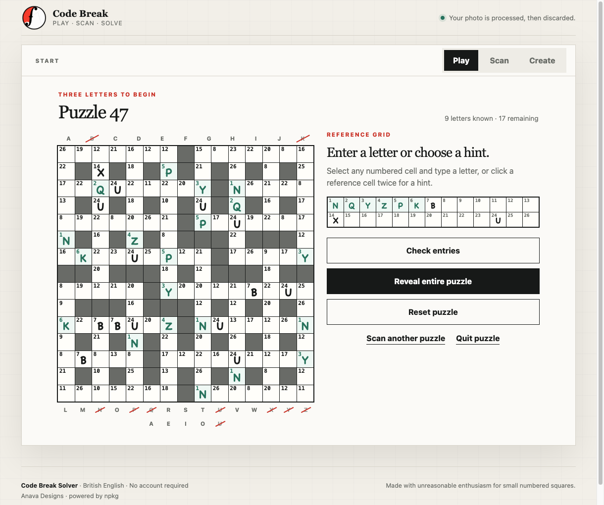

..
   psym :: documentation rendered from source.
   Do not edit this artifact directly.

cdbr
====

Solve Code Break puzzles from photographs.

**Play at** `codebreak.foghub.com <https://codebreak.foghub.com>`__\ **.** Open a puzzle from the collection, scan one from your book, or create your own. The hosted app runs in your browser and needs no installation or account.

.. toctree::
   :maxdepth: 2
   :caption: Contents:

   01_getting_started/index
   02_user_guide/index
   03_reference/index
   04_dev_guide/index
   05_about/index
